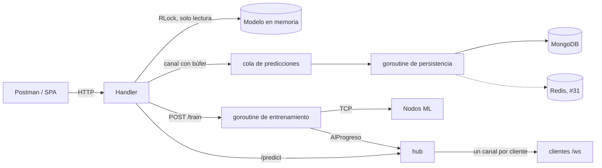

# API REST + WebSocket (PC4)

Código en `internal/api` (lógica) y `cmd/api` (ejecutable). Contrato OpenAPI en `internal/api/openapi.yaml`, servido en `/openapi.yaml` y como Swagger UI en **`/docs`**.

## Endpoints

| Método y ruta | Qué hace |
|---|---|
| `GET /health` | Estado, si hay modelo, nº de variables, nodos configurados |
| `POST /predict` | Una persona `{"entrada":[...]}` o un lote `{"columnas":[...],"filas":[[...],...]}` (máx. 1000; `columnas` opcional). Son 50 variables sin escalar, en el orden de `data/modelo/columnas.json`. Una persona devuelve probabilidad, clase, umbral, latencia y origen (`calculo`/`cache`); un lote devuelve `predicciones` en el mismo orden, `total`, `positivas` y la latencia del lote |
| `POST /train` | Entrena en los nodos ML por TCP (hiperparámetros opcionales). Responde `202` con el ID; solo uno a la vez (`409` si ya hay otro) |
| `GET /metrics` | Modelo vigente, clúster (nodos, entrenando), API (mediana/p95 de latencia, goroutines, memoria), última ejecución, métricas por época y evaluación |
| `GET /ws` | WebSocket con eventos JSON: `conectado`, `prediccion`, `prediccion_lote`, `inicio`, `progreso`, `fin`, `error` y `metricas` (cada 5 s) |
| `GET /docs`, `GET /openapi.yaml` | Swagger UI y especificación |

Los errores son siempre `{"error": "..."}` con el código HTTP adecuado (400, 409, 503). Cada respuesta incluye la cabecera `X-Latencia-ms`. CORS abierto para la SPA del entregable 3.

## Cómo funciona en Go



- **Modelo compartido:** `sync.RWMutex`. Muchas lecturas (`/predict`) y una sola escritura al terminar un entrenamiento. El modelo es de solo lectura al predecir, así que se usa fuera del cerrojo.
- **Lotes:** `filas` usa `Modelo.ProbabilidadLote`, que reparte las filas entre goroutines (cada una escribe en su propio rango de la salida, sin mutex). Es el formato que genera `mise run data:prueba` (`data/prueba/predicciones.json`), así que `mise run pc4:latencia` funciona sin parámetros. No consulta la caché y avisa por WebSocket con un solo evento `prediccion_lote`.
- **`/predict` no espera a la base de datos:** envía la predicción a un canal con búfer (1024) y una goroutine la guarda en Mongo/caché. Si la cola se llena, se descarta el registro y se cuenta (`predicciones_descartadas`) antes que frenar la respuesta.
- **Un entrenamiento a la vez:** `atomic.Bool` con `CompareAndSwap`. El entrenamiento corre en su propia goroutine y usa `internal/coordinador` (parameter server por TCP).
- **WebSocket:** un hub con un canal con búfer por cliente; si un cliente es lento se le descarta el evento en vez de bloquear a quien publica. Una sola goroutine escribe por conexión (requisito de `gorilla/websocket`).
- **Cierre ordenado:** `http.Server.Shutdown`, luego `Servidor.Cerrar()` (cancela, vacía la cola y espera a las goroutines).
- **Redis (#31):** la interfaz `api.Cache` ya está conectada a `/predict`; solo falta una implementación.
- **JWT:** no se implementa en el PC4 (el enunciado lo marca como opcional). Se hará con el inicio de sesión de la SPA en el entregable 3.

## Ejecutar

```bash
mise run db:up                                   # MongoDB
# nodos ML (en otras terminales; cada uno con su fragmento de datos)
go run ./cmd/nodo -servidor :9001 -nodo nodo-1 -csv data/modelo/train_raw.csv -max-filas 50000
go run ./cmd/nodo -servidor :9002 -nodo nodo-2 -csv data/modelo/train_raw.csv -max-filas 50000
mise run api -nodos localhost:9001,localhost:9002 -mongo mongodb://localhost:27017
```

```bash
curl localhost:8080/health
curl -X POST localhost:8080/train -d '{"epocas":6,"lote":1024}'
curl localhost:8080/metrics
mise run data:prueba                             # crea data/prueba/predicciones.json (lote de 30 filas)
mise run pc4:latencia                            # mediana y p95 -> reports/pc4/latencia_*.{csv,json}
```

En Postman: `POST http://localhost:8080/predict`, Body → raw → JSON `{"entrada": [ ...50 números... ]}`. El tiempo de respuesta aparece arriba a la derecha (captura para #32).

## Pruebas

`mise run test:api` (con `-race`): validación de entradas, predicción y persistencia, 200 predicciones concurrentes, caché, Swagger, métricas, 409/400/503 y **entrenamiento de extremo a extremo con 2 nodos TCP reales** con progreso por WebSocket.
