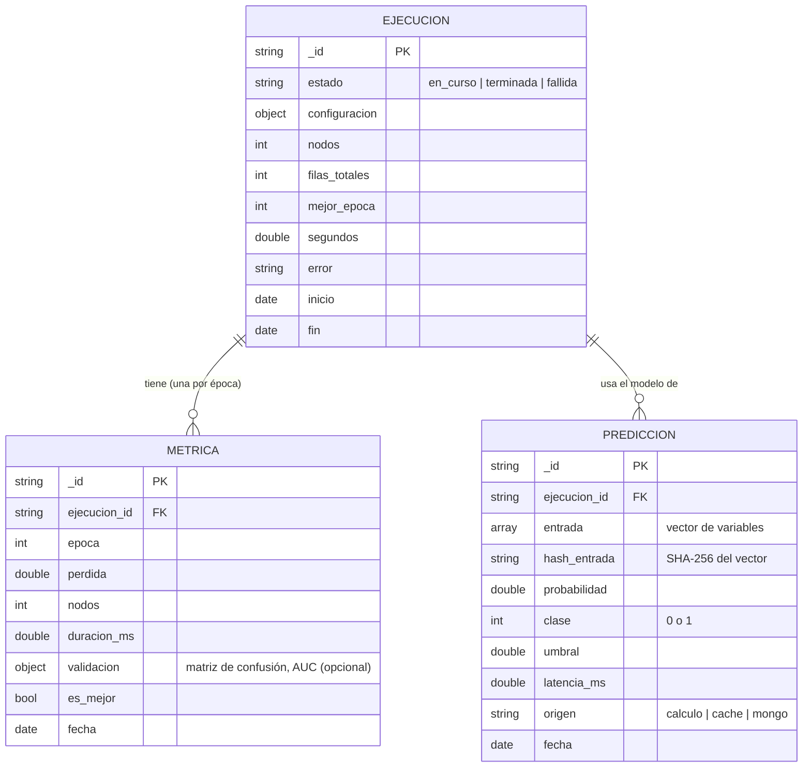

# Base de datos (PC4): MongoDB

Nivel **persistente** del sistema (el nivel de caché con Redis es el issue #31). Código en `internal/almacen`.

## Por qué MongoDB
- Las métricas de entrenamiento y las matrices de confusión son documentos anidados; no necesitan joins.
- Escritura frecuente de métricas (una por época) y predicciones, con lecturas casi siempre "las últimas N": encaja con índices descendentes por fecha.
- El esquema puede crecer (nuevas métricas) sin migraciones.

## Entidades



`configuracion` guarda solo los campos persistibles de `logreg.Configuracion` (tasa, épocas, lote, L2, peso de clase positiva, semilla, tolerancia, paciencia y mejora mínima); el original trae un conjunto de datos y un callback que no se pueden serializar.

## Índices

| Colección | Índice | Para qué |
|---|---|---|
| `ejecucion` | `{inicio: -1}` | Últimas ejecuciones |
| `ejecucion` | `{estado: 1, inicio: -1}` | Filtrar por estado (p. ej. en curso) |
| `metrica` | `{ejecucion_id: 1, epoca: 1}` **único** | Curva de una ejecución; evita épocas duplicadas |
| `prediccion` | `{fecha: -1}` | Últimas predicciones |
| `prediccion` | `{hash_entrada: 1, fecha: -1}` | *Fallback* de la caché (#31): predicción más reciente de una entrada |
| `prediccion` | `{ejecucion_id: 1, fecha: -1}` | Predicciones por modelo |

## Repositorio

`almacen.Repositorio` (interfaz) con dos implementaciones: `Mongo` (driver oficial, pool de conexiones propio) y `Memoria` (`sync.RWMutex`, para pruebas). Los errores se envuelven con `%w`; los documentos inexistentes devuelven `almacen.ErrNoEncontrado`.

## Probar y ver los registros

```bash
mise run db:up                    # MongoDB en Docker
mise run test:almacen:mongo       # misma batería contra memoria y Mongo real
mise run db:seed                  # 1 ejecución, 8 métricas (historial real de Go), 20 predicciones
docker exec vacunas-mongo mongosh --quiet --eval 'db.getSiblingDB("vacunas_prueba").ejecucion.find()'
```

La base de pruebas es `vacunas_prueba`; las pruebas de integración crean y borran bases `vacunas_test_*`. `mise run check` no necesita MongoDB.
