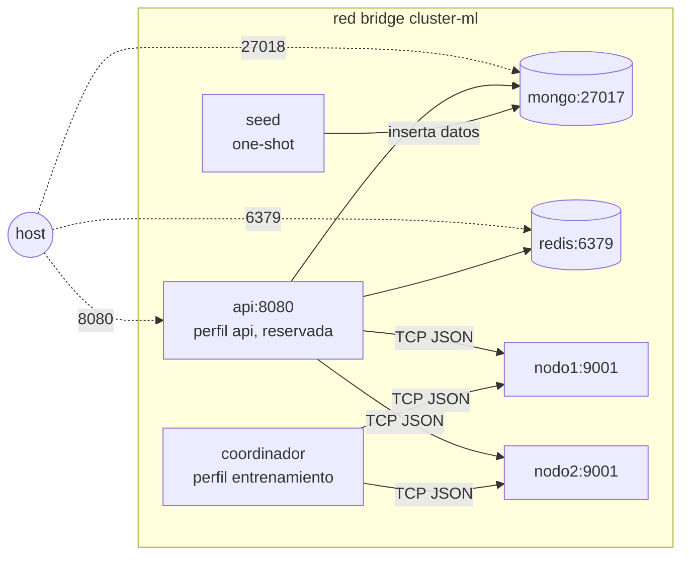

# Docker Compose del clúster ML (PC4)

Una sola imagen (`vacunas-ml:local`, definida en el `Dockerfile` de la raíz)
contiene todos los programas de `./cmd` compilados en `/app/bin`; cada servicio
solo cambia el `command`. Las variables salen de `.env` (copia `.env.example`).

## Servicios y red



| Servicio | Imagen | Puerto host → contenedor | Volumen | Healthcheck |
|---|---|---|---|---|
| `mongo` | `mongo:7` | `${MONGO_PUERTO_HOST:-27018}` → 27017 | `mongo-datos` | `mongosh --quiet --eval "db.adminCommand('ping')"` |
| `seed` | `vacunas-ml:local` | — | `./reports/go` (solo lectura) | — (termina con código 0) |
| `redis` | `redis:7-alpine` | `${REDIS_PUERTO_HOST:-6379}` → 6379 | `redis-datos` (AOF) | `redis-cli ping` |
| `nodo1` | `vacunas-ml:local` | — (interno 9001) | `./data/prueba` → `/datos` (ro) | `nc -z localhost 9001` |
| `nodo2` | `vacunas-ml:local` | — (interno 9001) | `./data/prueba` → `/datos` (ro) | `nc -z localhost 9001` |
| `coordinador` | `vacunas-ml:local` | — | `./reports/pc4` | — (perfil `entrenamiento`) |
| `api` | `vacunas-ml:local` | `${PUERTO_API:-8080}` → 8080 | — | — (perfil `api`, reservada) |
| `spa` | — | — | — | Solo comentada; corresponde al entregable 3 (TB2) |

## Levantar

```bash
cp .env.example .env            # una sola vez
mise run data:prueba            # genera data/prueba/nodo1.csv y nodo2.csv (rama feature/evidencias-32)
mise run docker:up              # = docker compose up -d --build
mise run docker:ps
```

`data/prueba/nodo{1,2}.csv` no se versionan y los genera la tarea
`data:prueba` (issue #32). Sin ellos los nodos no arrancan. Para una prueba
manual basta con dos CSV numéricos con cabecera y la columna `deserto` (0/1)
al final.

Para comprobar la semilla:

```bash
docker compose exec mongo mongosh --quiet vacunas_prueba --eval "db.prediccion.countDocuments()"
mise run docker:mongo           # mongosh interactivo
```

## Entrenar contra los nodos

```bash
mise run docker:entrenar
```

Ejecuta el coordinador (perfil `entrenamiento`) y escribe en `reports/pc4/`
`docker_servidor.json` (versionable) y `modelo_docker.json` (ignorado por git).
El servicio no se levanta con `up`: solo con `run --rm`.

## Activar la API (reservada)

`cmd/api` aún no existe (issues #29/#31). Cuando se fusione, el `Dockerfile`
la compilará sola y se activa con:

```bash
docker compose --profile api up -d
```

Los nombres de variables del servicio `api` son provisionales y deben
ajustarse al fusionar.

## Conflicto con `mise run db:up`

`db:up` crea un contenedor llamado `vacunas-mongo` en el puerto host 27017.
Compose publica su Mongo en **27018** y no fija `container_name`, así que
ambos pueden convivir. Usa uno u otro: `db:up` para desarrollo con
`go run ./cmd/seed`, Compose para el clúster completo.

## Evidencias

```bash
docker compose ps -a        > reports/pc4/docker_compose_ps.txt
docker compose logs nodo1 nodo2 coordinador > reports/pc4/docker_logs.txt
```

Se versionan solo los `.txt` y `docker_servidor.json`; nunca `data/`, `.env`
ni `modelo_*.json`. Para limpiar: `mise run docker:down` (conserva volúmenes).
