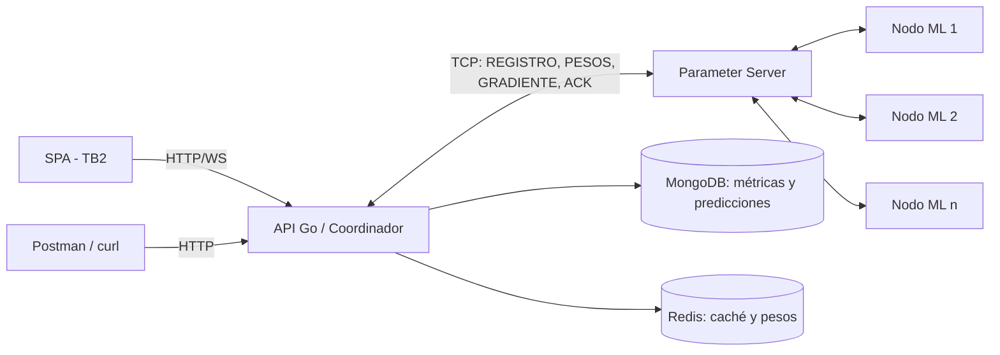

# Plan del entregable 2 (PC4)

**Fecha límite:** 21/11/2026, 23:30 (semana 13). **Fecha de planificación:** 19/11/2026.
Quedan dos días: este plan prioriza un sistema **end to end verificable** antes que
ampliar funcionalidad. La SPA corresponde al entregable 3 (TB2); en PC4 el
`docker-compose` debe dejarla reservada o documentada.

## 1. Alcance exigido por el enunciado

| Requerimiento PC4 | Issue | Evidencia en el informe |
|---|---|---|
| Distribución: cluster de nodos ML, topología de red y explicación en Go | #7, #28 | Diagrama de secuencia, logs de 2 nodos, tabla de convergencia |
| API: Swagger, funcionamiento en Go y latencia < 100 ms (Postman) | #29 | `/docs`, capturas Postman, `reports/pc4/latencia_api.csv` |
| Bases de datos: diseño de entidades y registros | #30, #31 | Diagrama de entidades, capturas `mongosh` / `redis-cli` |
| Evidencias de implementación y pruebas con datos de prueba | #32 | `reports/pc4/`, datos en `data/prueba/` (ignorados) |
| Documentación + correcciones + reporte de participación | #33 | Informe `.docx`, anexos y reporte |
| Subir cambios y actualizar Kanban | #27, todos los PR | Historial Git Flow, captura del tablero |

La tabla es el contrato del entregable: **si no hay evidencia en `reports/pc4/`,
el punto no se considera terminado**.

## 2. Arquitectura objetivo



**Topología:** estrella con el coordinador en el centro. Se eligió sobre malla
porque la regresión logística distribuida necesita un único punto de
sincronización de pesos; el coste de coordinación es `O(n)` y evita conflictos
de actualización. El protocolo va sobre TCP con *framing* de longitud y mensajes
tipados. La concurrencia interna usa **canales** para el flujo de trabajo y un
**mutex** solo para el estado compartido de pesos; ninguna goroutine escribe
memoria ajena directamente (ver invariantes en `AGENTS.md`).

## 3. Paquetes de trabajo

| WP | Issue | Entregable | Depende de | *Definition of done* |
|---|---|---|---|---|
| 0 | #27 | Plan y todo list | — | Este documento + `docs/tareas.md` + issues con criterios |
| 1 | #7 | Parameter server y protocolo TCP | — | 2 nodos simulados actualizan pesos sin carreras (`-race`) |
| 2 | #28 | Nodo ML worker | #7 | 2 nodos producen la misma pérdida que 1 (tol. `1e-9`) |
| 3 | #30 | MongoDB | — | Entidades, índices y registros de prueba consultables |
| 4 | #31 | Redis | #30 | Caché con TTL y *fallback* a Mongo desde la API |
| 5 | #29 | API REST + Swagger + WebSocket | #7, #3, #4 | `/health`, `/predict`, `/train`, `/metrics`, `/docs`, `/ws`; latencia < 100 ms |
| 6 | #9 | Docker Compose | WP 1-5 | `docker compose up -d` levanta API + 2 nodos + Mongo + Redis |
| 7 | #32 | Evidencias | WP 1-6 | `reports/pc4/` completo con capturas y tablas |
| 8 | #33 | Informe y participación | #32 | `.docx` con la estructura oficial y apéndice de correcciones |

Responsables sugeridos (ajustar en el Kanban): **concurrencia/Go** → WP1, WP2;
**API/datos** → WP3, WP4, WP5; **DevOps/documentación** → WP0, WP6, WP7, WP8.
Las ramas se crean como `feature/<slug>-<numero>` desde `develop`.

## 4. Cronograma

| Momento | Acción |
|---|---|
| 19/11 (hoy) | Publicar plan e issues (#27). Abrir ramas WP1 y WP3 en paralelo. Diseñar el protocolo. |
| 20/11 | Completar WP1, WP2, WP3, WP4, WP5. Integrar WP6 y hacer *smoke test* end to end. |
| 21/11 hasta 20:00 | WP7 (evidencias) y WP8 (informe). |
| 21/11 20:00-22:00 | Revisión cruzada del informe, Kanban en "Review" y reporte de participación. |
| 21/11 22:00 | *Freeze*: solo correcciones críticas. Entrega 23:30. |

**Plan de contingencia:** si se acorta el tiempo, priorizar WP1, WP2, WP5, WP6,
WP7 y WP8 (rúbrica de implementación + API + informe). Redis (#31) puede quedar
como mejora documentada, pero MongoDB (#30) no.

## 5. Convenciones de evidencia

Todo va en `reports/pc4/` (los CSV reales de Go ya versionados en `reports/go/`
no se tocan):

- `latencia_api.csv`: mediana y p95 de `/predict` con al menos 30 peticiones.
- `postman_*.png`: una captura por endpoint, con el tiempo de respuesta visible.
- `escalamiento_cluster.csv`: 1, 2 y 4 nodos con pérdida final y tiempo.
- `docker_compose_ps.txt`, `race_test.txt`, `kanban.png`.
- `data/prueba/`: CSV pequeño de prueba; está ignorado por git, no subir datos reales.

## 6. Estructura del informe

Carátula → resumen → índice → descripción del problema y motivación → objetivos →
desarrollo → conclusiones → recomendaciones → bibliografía (APA 7) → anexos
(enlace del repo, video, documentos).

En **desarrollo** se incluyen, en este orden: distribución, API, bases de datos,
evidencias. El nombre del archivo es
`1ACC0065_PC4_202610_Informe_UXXXXXXXX.docx`.

> **Correcciones:** el enunciado indica que el informe de PC4 debe contener "el
> entregable 3 con las correcciones". Como los entregables numerados son
> 1 = PC3, 2 = PC4 y 3 = TB2, interpretamos que se refiere a la versión
> corregida del **entregable 1 (PC3)**. Confirmar con el docente; mientras tanto
> se añade el apéndice "Correcciones al entregable 1 (PC3)".

## 7. Para agentes y personas

1. Leer `docs/tareas.md` (snapshot generado) y elegir **un** `- [ ]`.
2. Ejecutar `gh issue view <N>` para ver los criterios completos antes de empezar.
3. Crear rama desde `develop`, trabajar solo ese issue y no tocar `data/` real.
4. PR a `develop` con `Closes #N`, plantilla completada y evidencia adjunta.
5. Verificar con `mise run check` (o `go vet ./... && go test -race ./...`).
6. Regenerar el snapshot con `python src/generar_tareas.py`.

`docs/tareas.md` **no se edita a mano**: GitHub Issues es la fuente de verdad.

## 8. Riesgos

| Riesgo | Mitigación |
|---|---|
| Dos días para todo el sistema | Ver plan de contingencia: MVP end to end; evidencias se capturan durante el desarrollo, no al final |
| Condiciones de carrera en los pesos | Prueba `-race` desde el WP1, antes de conectar la API |
| Latencia > 100 ms | Caché en Redis y conexiones reutilizadas; medir desde el primer día |
| Fuga de datos del dataset real | Solo `data/prueba/` en las demos; nunca subir `data/` |
| Configuración de mise aún no fusionada (PR #26) | Los comandos equivalentes en Go/Python están documentados en `AGENTS.md` |

## 9. Comandos útiles

```bash
# Instalar herramientas (si PR #26 ya está fusionada)
mise install --locked && mise run setup
mise run check                       # vet + go test -race

# Equivalente sin mise
go vet ./... && go test -race ./...

# Tablero y snapshot
gh issue list --label pc4
python src/generar_tareas.py

# Contenedores
docker compose config
docker compose up -d
docker compose ps
```
