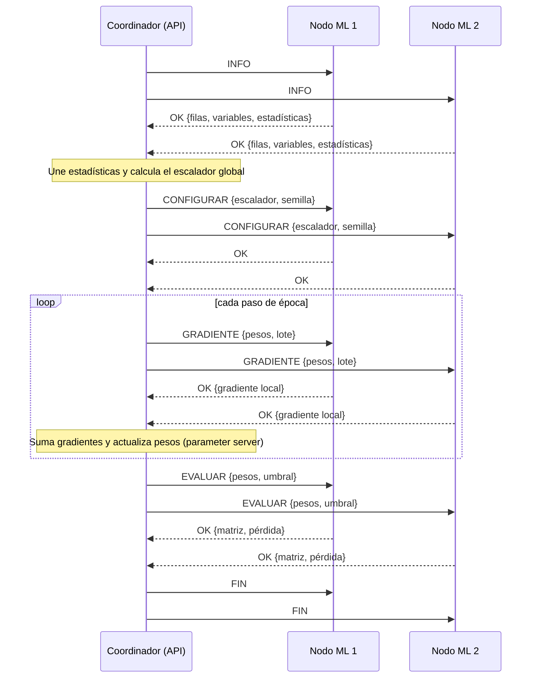

# Protocolo TCP del clúster ML (PC4)

El protocolo ya está implementado en la dependencia
`github.com/franztoledo/logreg` v0.1.0 (`protocolo.go`, `coordinador.go` y
`nodo.go`). El proyecto no lo reimplementa: lo envuelve en
`internal/coordinador` y lo usan el `cmd/coordinador` y, más adelante, la API.

## Transporte

- TCP, un mensaje JSON por línea (`json.Encoder` / `json.Decoder`).
- Tiempo máximo por petición configurable (`-tiempo-espera`, por defecto 30 s).
- Mensajes: `INFO`, `CONFIGURAR`, `GRADIENTE`, `EVALUAR`, `FIN`, `OK`, `ERROR`.

## Secuencia



## Concurrencia y seguridad

- `Coordinador.difundir` lanza **una goroutine por nodo** y espera todas las
  respuestas (barrera). Cada goroutine usa únicamente la conexión de su nodo.
- El estado compartido (conexiones, nodos activos y pesos) se protege con un
  `sync.Mutex`; los resultados vuelven por un canal, sin escritura compartida.
- Si un nodo falla, se marca inactivo y el entrenamiento continúa con los
  restantes, siempre que quede al menos `MinimoNodos`.
- Las pruebas `internal/coordinador/coordinador_test.go` levantan 2 nodos TCP
  reales y verifican equivalencia con el entrenamiento local bajo `-race`.

## Comando de verificación

```bash
mise run check   # o: go vet ./... && go test -race ./...
```
