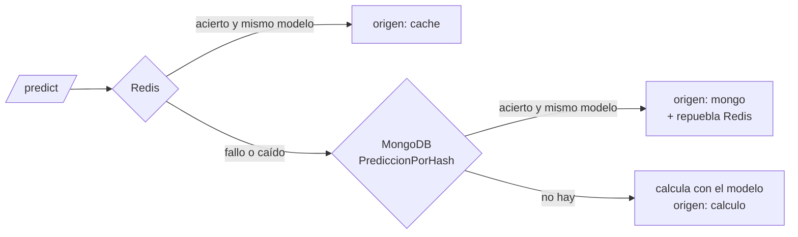

# Caché con Redis (issue #31)

`internal/cache` implementa `api.Cache` (y `api.CachePesos`) sobre Redis con
`go-redis`. La API **funciona igual sin Redis**: la caché es solo una
aceleración.

## Qué se guarda

| Clave | Contenido | TTL |
|---|---|---|
| `pred:<sha256 de la entrada>` | Última predicción de esa persona (JSON de `almacen.Prediccion`) | `REDIS_TTL` (5 min por defecto) |
| `modelo:pesos` | Modelo vigente: pesos, sesgo, escalador, umbral y `ejecucion_id` | 24 h |

## Flujo de `POST /predict` (una persona)



- Solo se sirven predicciones del **modelo vigente** (`ejecucion_id` igual):
  tras reentrenar, las anteriores se ignoran.
- Los lotes (`filas`) no consultan la caché: calcular es más barato que una
  consulta por fila.
- `GET /metrics` informa `cache_activa` y `origenes` (`calculadas`, `cache`, `mongo`).

## Tolerancia a fallos

- Tiempos de espera de 100 ms para conectar, leer y escribir (no rompe el
  requisito de latencia < 100 ms) y sin reintentos.
- **Cortacircuitos:** tras el primer error se deja de consultar a Redis durante
  5 s (un solo aviso en el log) y la API sigue con MongoDB o calcula. Después
  vuelve a intentarlo sola.
- Si Redis no está al arrancar, la API inicia igual con un aviso.

## Pesos del modelo

Al terminar cada `POST /train` los pesos se guardan en `modelo:pesos`. Si la API
arranca sin archivo de modelo (p. ej. un contenedor nuevo), los recupera de
Redis y puede responder `/predict` sin reentrenar.

## Configuración

| Variable | Flag | Por defecto |
|---|---|---|
| `REDIS_URL` | `-redis` | vacío = sin caché (compose: `redis://redis:6379/0`) |
| `REDIS_TTL` | `-redis-ttl` | `5m` (compose: `300s`) |
| `EPOCAS`, `LOTE`, `PESO_POSITIVO` | `-epocas`, `-lote`, `-peso-positivo` | valores por defecto de `POST /train` (10, 1024, **12.43**) |

`POST /train` ahora usa `peso_positivo` 12.43 (el del PC3) cuando la petición no
lo indica; con 1 el modelo casi nunca predice la clase minoritaria.

## Probar

```bash
mise run docker:up                       # Mongo + Redis + 2 nodos
mise run api -redis redis://localhost:6379/0 -mongo mongodb://localhost:27017
# dos veces la misma persona: origen "calculo" y luego "cache"
curl -s -X POST localhost:8080/predict -H "Content-Type: application/json" -d @docs/ejemplos/prueba-p1.json
docker exec vacunas-redis redis-cli --scan --pattern "pred:*"
docker exec vacunas-redis redis-cli ttl pred:<hash>
```

Las pruebas (`mise run test:cache`) usan un Redis en memoria (`miniredis`); con
`REDIS_URL` definida corren contra un Redis real.
